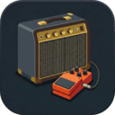

<p align="center"></p>

# AmpSim

Simulador de amplificador de guitarra e pedais em Go, feito como estudo de DSP:
pré-amp com saturação sobreamostrada, tone stack, power amp, gabinete por resposta ao
impulso (IR) e 18 pedais: gate, compressor, wah, oitavador, filtro de sintetizador, drive (boost/overdrive/distorção/fuzz), EQ
paramétrico, chorus, flanger, phaser, vibe, vibrato, tremolo, rotary (Leslie), pitch shifter, delay e reverb — tocando em
tempo real, com GUI.

Os algoritmos começaram como protótipos em Python (`referencia_python/`) e foram portados
para Go em streaming, validados contra as saídas do Python.

## O que tem

- **Amp em três partes** — pré-amp (ganho, grave, médio, agudo, com a voz Moderno, Americano, Britânico,
  **Britânico Mod** ("Brit. Mod") ou **High Gain**; Americano e Britânico são os circuitos TMB do Fender Bassman e do
  Marshall JTM45 modelados, o High Gain tem pré próprio, três estágios em cascata ajustados medindo um amp moderno de
  alto ganho, e a Britânico Mod é o britânico com um estágio de ganho a mais, do crunch ao hard rock; em todos, a curva
  do knob de grave sai do próprio circuito, em passos iguais de dB), power amp (presença,
  volume) e gabinete (IR, low cut, high cut). Vêm incluídas três IRs (1x10 SM58, 2x12 SM57, a padrão, e 4x12 SM7),
  e o gabinete também abre qualquer WAV de IR.
- **Amp NAM** — o seletor **Amp: Simulado | NAM** troca o pré-amp por um modelo
  [NAM](https://github.com/sdatkinson/neural-amp-modeler) (Neural Amp Modeler), executado em Go puro e validado
  contra a inferência oficial. Vêm incluídas 11 capturas do pré do Warm Music GT208 (veja `capturas/`), em
  tamanho lite ou completo; também abre arquivos `.nam` (WaveNet, inclusive o formato 0.7 da TONE3000).
  O app abre no modo NAM.
- **EQ paramétrico de 5 bandas** (shelf de graves, 3 médios com Q ajustável, shelf de agudos e level), com a curva
  de resposta desenhada no pedal (arraste os pontos; roda do mouse = Q; duplo clique zera); anda pela cadeia como os outros pedais (padrão: no loop de efeitos).
- **Monte a sua cadeia**: o botão **+** adiciona pedais (agrupados em dinâmica, drive, filtro, modulação, tom e
  ambiência) e cada pedal tem **Remover**; a cadeia mostra só o que você usa.
- **Drive** com 5 modos, cada um com os knobs do pedal de referência (Boost: Boost e Tone; Overdrive estilo
  Tube Screamer; Distorção estilo RAT; Fuzz estilo Fuzz Face: Fuzz e Volume; Muff estilo Big Muff: Sustain, Tone e
  Volume; ceifamento com oversampling 4x), ou **Tipo NAM**: uma captura de pedal no lugar dos modos, com Entrada e
  Level. Vêm incluídas 10 capturas só do pedal: Ibanez TS7 (modos TS9 e HOT, 9 ajustes) e Oliver SD-10 (SD-1); também
  abre arquivos `.nam`. **Wah** automático
  (envelope, LFO ou fixo), **Octave** (−1/−2/+1 oitava, estilo OC-2), **Rotary** (Leslie, lento/rápido com
  aceleração), **Vibe** (chorus/vibrato) e **Pitch** (2 vozes até ±1 oitava, emendas sincronizadas com o período).
- **Synth**: filtro de sintetizador (ladder de 4 polos estilo Moog, LP/BP/HP, ressonância até oscilar) com o corte
  modulado por envelope, LFO ou uma **sequência de 8 passos** editada no próprio pedal (com tap tempo e glide), e
  **FM** pelo próprio sinal da guitarra.
- **Cadeia configurável** com **loop de efeitos** (send/return): os pedais podem ficar na
  frente do amp, entre o pré-amp e o power amp, ou depois do gabinete. A ordem muda ao vivo,
  sem estalo.
- **Estéreo** (botão ao lado de CADEIA DE SINAL; ligado por padrão, salvo em `~/.config/ampsim/ajustes.json`): a
  entrada do amp é mono, e depois do pré-amp a cadeia passa a ter L e R. Chorus, flanger, phaser e vibe defasam o
  LFO do R, o tremolo vira auto-pan, o rotary ganha o segundo microfone, o reverb tem reflexões próprias no R e o
  delay tem os modos **Duplo** (o R um pouco mais atrasado) e **Ping-pong**, todos com o knob **Largura** (0 = mono).
  Power amp e gabinete processam os dois canais. Desligado, tudo soa como em mono, com L e R iguais. Gravar e
  exportar saem em estéreo quando ele está ligado.
- **Limitador de segurança** na saída (botão ao lado de Estéreo; ligado por padrão, salvo no mesmo `ajustes.json`):
  segura os picos em −0,3 dBFS sem latência e sem mexer no som abaixo disso; o LED do rodapé vira **LIMIT** e
  acende em âmbar quando ele atua. Desligado, o que passa de 0 dBFS é cortado (LED **CLIP**). Vale também para
  gravar e exportar; no `ampcli`, use `-limitador`.
- **Tempo real**: convolução particionada de latência zero, oversampling 4x com latência de
  32 amostras, nenhuma alocação na thread de áudio, saída idêntica com qualquer tamanho de bloco.
- **GUI (Gio)**: cabeçote e gabinete com knobs, cadeia em que se arrastam os pedais, pedais
  que abrem por cima da tela, transporte com loop de trecho, medidores e bypass A/B.
- **Gravar** a saída e a DI (para reamplificar) em WAV 24 bits, e **exportar** um arquivo processado pelo som atual.
- **Afinador** (YIN, saída muda enquanto afina; pelo **Menu** ou tecla A) e **tap tempo** no delay e no tremolo
  (botão TAP ou tecla T, com subdivisões).
- **Analisador de espectro** na linha da ENTRADA: espectro da saída e da entrada (a guitarra antes da cadeia,
  alinhada pela média para comparar o formato), com a curva do EQ e os cortes do gabinete por cima; clique para
  abrir a versão grande, com leitura sob o ponteiro.
- **Menu** (canto superior direito): Áudio…, Afinador, **Backup dos presets…** (um `.zip` com os seus presets, a
  pedaleira e os `.nam`/IRs que eles usam), **Restaurar presets…** (guarda antes o estado atual em
  `~/.config/ampsim/backups`), **Atalhos** (teclado e mouse) e Sobre.
- **Presets**: 24 de fábrica em 4 bancos temáticos da pedaleira: **Limpos** (Clean, Country, Funk, Surf, New
  Wave, Pop Anos 80), **Drive e rock** (Blues, Crunch, Rock Clássico, Treble Booster, Solo Hard Rock, Metal),
  **Efeitos e texturas** (Psicodélico, Fuzz Oitavado, Modulação, Worship, Ambiente, Synth), cada um com seu amp,
  gabinete e pedais, e **Amps clássicos** (Americano Limpo, Americano Quebrando, Britânico Crunch, Britânico
  Saturado, High Gain Moderno, Moderno Limpo), só o amp simulado e o gabinete, a base para montar com os pedais
  (no plugin, os "AmpSim Pedal"); todos no mesmo volume; e os seus, salvos em `~/.config/ampsim/presets`
  (JSON, o mesmo formato do estado do plugin); `-preset Metal` funciona no app e no CLI.
- **Pedaleira de presets** abaixo da cadeia: 6 footswitches por banco, como um controlador (teclas 1 a 6), com o
  nome do banco (ex.: LIMPOS) entre as setas. **Editar** abre a matriz de bancos × footswitches: clique numa célula
  para escolher o preset, dê nome aos bancos, acrescente bancos (até 10) ou **Restaurar padrão**.
  **Spillover** (ligado por padrão): na troca de preset, as repetições do delay e a cauda do reverb continuam
  soando com os ajustes do preset anterior enquanto o novo já toca; desligado, a cauda some num fade de 30 ms.
- **CLI** para processar arquivos offline.
- **Plugin LV2 e CLAP** que aplica um preset numa faixa, e os pedais sozinhos (veja [Plugin](#plugin-lv2-e-clap)).

## Requisitos

- Go 1.26+ e um compilador C (o áudio usa [malgo](https://github.com/gen2brain/malgo) / miniaudio via cgo)
- Recomendado: compilar com `GOEXPERIMENT=simd` (SIMD experimental do Go): o NAM usa AVX2 + FMA e o modelo
  completo gasta ~3× menos CPU. Os pacotes prontos já vêm assim; `ampsim -versao` mostra qual caminho está em uso.
  Para deixar como padrão nos seus builds: `go env -w GOEXPERIMENT=simd`
- Para a janela (Gio), no Ubuntu/Debian:
  ```
  sudo apt install libwayland-dev libx11-dev libx11-xcb-dev libxkbcommon-x11-dev \
                   libgles2-mesa-dev libegl1-mesa-dev libffi-dev libxcursor-dev libvulkan-dev
  ```
  Sem essas bibliotecas, compile só o console com `-tags nogui`.
- Opcional: `zenity` (diálogo de abrir arquivo na GUI)
- Para tocar ao vivo com baixa latência no Linux (PipeWire): `sudo apt install pipewire-jack`. O app usa a API JACK
  do PipeWire sozinho (não precisa de `pw-jack`); sem ela, usa o PulseAudio, com latência bem maior.

## Instalação

**Pacotes prontos (Linux, amd64)** — baixe na página de releases do GitHub:

```sh
sudo apt install ./ampsim_0.14.0_amd64.deb      # Ubuntu/Debian: instala no sistema, com as dependências
# ou, sem sudo:
tar xzf ampsim-0.14.0-linux-amd64.tar.gz && ampsim-0.14.0-linux-amd64/install.sh
```

Depois é só procurar **AmpSim** no menu de aplicativos (ou rodar `ampsim` / `ampsim-cli` no terminal).
Sem nenhuma IR escolhida, o gabinete usa a 2x12 SM57 incluída. Para gerar os pacotes a partir do código:
`scripts/empacotar.sh 0.14.0` (saem em `dist/`).

**Pelo Go:**

```sh
go install github.com/tatianno/ampsim/cmd/ampcli@latest   # CLI (offline)
go install github.com/tatianno/ampsim/cmd/ampapp@latest   # app em tempo real (precisa das bibliotecas acima)
GOEXPERIMENT=simd go install github.com/tatianno/ampsim/cmd/ampapp@latest   # idem, com o NAM em SIMD
go install -tags nogui github.com/tatianno/ampsim/cmd/ampapp@latest   # app só console
```

Ou clone o repositório e use `go run`, como abaixo.

## Uso

```sh
# GUI: toca um WAV em loop pelo amp (abre pausada: Play ou barra de espaço)
go run ./cmd/ampapp -arquivo minha_di.wav -ir meu_gabinete.wav

# guitarra ao vivo: escolha a entrada e o canal (veja os índices com -listar-dispositivos)
go run ./cmd/ampapp -fonte guitarra -entrada 0 -canal 1 -buffer 64
go run ./cmd/ampapp -listar-dispositivos

# console interativo (comandos: play, set pre.gain=8, on delay, mover delay depois cab, ab,
# fonte guitarra, trim 6, latencia, buffer 128, ...)
go run ./cmd/ampapp -console -arquivo minha_di.wav -ir meu_gabinete.wav

# processar um arquivo offline
go run ./cmd/ampcli -in minha_di.wav -ir meu_gabinete.wav -out saida.wav -on delay -set pre.gain=8
go run ./cmd/ampcli -listar          # módulos e parâmetros
go run ./cmd/ampcli -in minha_di.wav -out saida.wav -preset Ambiente -estereo -set delay.stmode=1   # estéreo, ping-pong
```

Grave a guitarra direto na interface (DI), sem amp nem pedal, com pico entre −12 e −6 dBFS.
Ao vivo, ajuste o **Trim** até o nível da guitarra ficar na faixa ideal marcada no painel ENTRADA.
Para saber a latência real, ligue um cabo da saída da placa numa entrada e use **Menu → Áudio… → Medir latência**.
A IR pode ser qualquer WAV de resposta ao impulso de gabinete (qualquer taxa; é reamostrada).

## Plugin LV2 e CLAP

O plugin aplica um preset do app numa faixa: no **Audacity** (gravando a DI limpa e aplicando depois, como
efeito ou como efeito em tempo real) e em hosts que monitoram ao vivo (**Reaper**, Ardour, Carla). O som não é
editado no plugin: os presets são feitos no app. Vem em dois formatos, no mesmo arquivo: **LV2** (um efeito por
preset e por pedal) e **CLAP** (um efeito só, com a lista de presets; veja abaixo).

**Cada preset é um efeito**, pelo nome: **AmpSim: Clean**, **AmpSim: Americano Limpo**… e os seus (**AmpSim: Meu Som**).
O app mantém a lista em dia: ao abrir e ao salvar, apagar ou restaurar presets, ele reescreve o plugin em
`~/.lv2/ampsim.lv2`; o host mostra a lista nova quando é reaberto. Os controles de cada efeito:

| Controle | O que faz |
|---|---|
| Entrada | trim em dB: o nível da DI muda o quanto o amp e o drive saturam |
| Saída | volume em dB |
| Ligado | liga e desliga (desligado, sai o sinal seco, alinhado com a latência) |

Os **pedais e modulações** também vêm sozinhos, com os knobs do app: **AmpSim Pedal: Gate**, Compressor, Wah,
Octave, Synth, Drive (o modelado), EQ, Chorus, Flanger, Phaser, Vibe, Vibrato, Tremolo, Rotary, Pitch, Delay e
Reverb, cada um com **Ligado**. Os seletores viram caixa de marcar quando têm duas posições ("Velocidade
(Rápido)") ou um número com a legenda no nome ("Modo (0 Boost, 1 Overdrive, 2 Distorção, 3 Fuzz, 4 Muff)"): uma
lista de opções sai embaralhada no Audacity. Amp e gabinete vêm pelos presets.

Cada efeito vem **mono** e **estéreo** ("AmpSim: Clean (estéreo)", "AmpSim Pedal: Delay (estéreo)"). O mono é
para a faixa da DI em mono (no Audacity, numa faixa estéreo, cada canal passa pelo efeito); o estéreo mistura a
entrada em mono e sai em dois canais, com a Largura das modulações e o delay ping-pong. **No Reaper, use o
estéreo** (as faixas são estéreo: um efeito mono processa só o canal 1).

**CLAP** (Reaper, Bitwig…): um efeito só, **AmpSim**, estéreo, com os parâmetros **Preset** (a lista com os de
fábrica e os seus, pelo nome, lida ao abrir o efeito), Entrada, Saída e **Bypass**. Trocar o Preset (à mão ou
por automação) muda o som com o áudio rodando, com o spillover do app; a latência é sempre a mesma (96 amostras).
O projeto guarda uma cópia do preset: se ele for apagado no app, o Preset mostra "… (cópia do projeto)".

Instalação:

- **`.tar.gz`**: o `install.sh` copia o plugin para `~/.lv2/ampsim.lv2` e liga `~/.clap/ampsim.clap` a ele.
- **`.deb`**: o pacote instala o `.so` em `/usr/lib/ampsim/`; **abra o app uma vez** e ele monta o plugin em
  `~/.lv2` e `~/.clap` (cada usuário tem os seus presets). Remover o pacote apaga esse plugin.
- **Código**: `plugin/lv2/build.sh --install`.

O LV2 e o CLAP são o mesmo arquivo (`ampsim.clap` é um link para o `ampsim.so`): abertos juntos no mesmo host, o
sistema carrega uma vez só.

Nos hosts que guardam o estado dos plugins (Ardour, Carla), o projeto leva uma **cópia do preset**: editar o
preset no app depois não muda o som do projeto. O Audacity 3.4 não guarda o estado: lá o efeito usa o preset
como ele está no app (o efeito aplicado já fica gravado no áudio). Apagar um preset tira o efeito da lista.

Para conferir sem DAW: `plugin/lv2/hostcheck/check.sh` carrega o LV2 pela lilv (a mesma biblioteca do Audacity)
e o CLAP por um host mínimo (`clapcheck.c`), compara a saída com o render offline do app, testa salvar e restaurar
o estado e, no CLAP, a troca de preset com o áudio rodando.

## testdata

Os arquivos de áudio de teste **não estão no repositório**. Para rodar os testes completos e
usar os caminhos padrão dos comandos, coloque em `testdata/`:

| Arquivo | Conteúdo |
|---|---|
| `testdata/guitarra_di.wav` | uma gravação DI de guitarra (alguns segundos) |
| `testdata/gabinete_2x12_sm57.wav` | a IR de gabinete (a mesma embutida em `capturas/`) |

e gere as referências do Python (usadas na comparação Go × Python):

```sh
python3 -m venv venv && venv/bin/pip install numpy scipy
venv/bin/python referencia_python/gerar_referencias.py   # grava em testdata/referencia/
```

Sem esses arquivos, os testes que dependem deles são pulados e o resto roda normalmente.

## Testes

```sh
go test ./...          # sem placa de som e sem janela (a GUI é testada simulando mouse e teclado)
go test -race ./...
GOEXPERIMENT=simd go test ./...   # os núcleos SIMD do NAM (comparados com os escalares)
```

## Estrutura

```
wav/                leitura e gravação de WAV
dsp/                filtros, saturação, oversampling, convolução, efeitos (Go puro)
engine/             cadeia, parâmetros, presets
cmd/ampcli/         processamento offline
cmd/ampapp/         app em tempo real: audio/ (malgo), source/ (player), ui/ (Gio)
plugin/             núcleo do plugin (presets, trim, estado); plugin/lv2/ = camada LV2 (C + cgo) e ttl/
referencia_python/  protótipos originais e gerador de referências
```

O plano de desenvolvimento, decisões e resultados medidos estão em [PLANO.md](PLANO.md).

## Licença

[MIT](LICENSE). Os arquivos de áudio usados nos testes não fazem parte do repositório nem desta licença.
